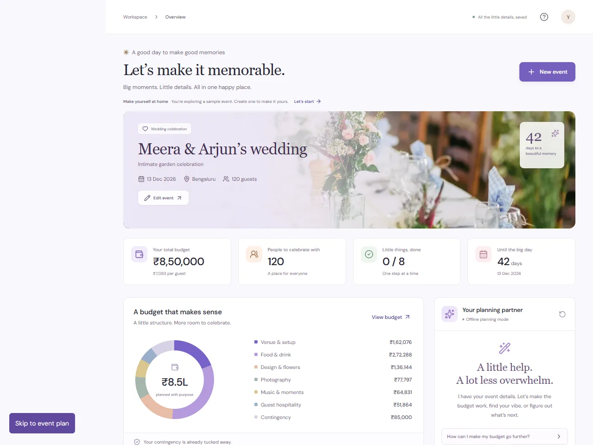

# Gatherly

Gatherly turns the first decisions for a wedding, birthday or community gathering into an editable event workspace: a reconciled budget, a dated checklist, vendor research requirements and celebration ideas.

The chosen vertical is **Celebration & Event Planning**. The product focuses on the practical gap between an event brief and a plan someone can act on. It keeps the budget and timeline predictable, then uses Gemini for optional language and idea enrichment.



**Current status:** Production build verified locally, including genuine Gemini plan generation and assistant replies. The public source repository is [Rahul21sai/Gatherly](https://github.com/Rahul21sai/Gatherly); hosting is being prepared.

## Product flow

1. Open the sample event or create an event with its date, city, guest count, budget, currency, style and priorities.
2. Generate a plan and review the Overview, Budget, Timeline, Vendors and Inspiration views.
3. Record spending, complete tasks, update vendor research status and save ideas. Switch between events saved in this browser.
4. Ask the assistant for help. Review a proposed constraint change before applying it; regeneration requires confirmation because it resets tracked progress for that event.
5. Download the plan as JSON or export dated tasks as a calendar file.

## Approach and decisions

**Deterministic planning owns the numbers.** A TypeScript planning engine creates allocations, totals, task dates and feasibility warnings. Amounts use whole currency units. It rounds a 10% contingency to the nearest unit, then distributes the remainder using the largest-remainder method so totals reconcile exactly. Relevant priority weights receive a 40% boost. Vendor amounts are planning allowances derived from the budget, not researched market quotes. A large guest count on a small budget or a compressed lead time surfaces a useful warning.

**Gemini enriches, rather than decides, the plan.** Server endpoints validate requests and bounded model output. Gemini can tailor summaries, ideas and assistant language; it cannot silently change financial totals or apply event changes. Missing credentials, timeouts, invalid output and provider failures fall back to the deterministic planner with an explicit offline label. An offline label means no Gemini enrichment was used; a hosted app still needs a connection to its own server to generate a plan.

**Local storage keeps the MVP focused.** Events persist in the current browser without accounts or a database. Corrupt stored data should recover safely. There is no cross-device sync or shared editing, and clearing browser data can remove saved work. JSON export provides a portable copy.

**Progress changes stay explicit.** Spend, task completion, vendor status and saved ideas belong to the current plan. Accepting an assistant constraint suggestion creates a fresh plan only after the user confirms the reset. Vendor status is a personal tracker; selecting “Booked” does not make or verify a booking.

## Stack and structure

- Next.js App Router, React and TypeScript.
- Zod for runtime validation, Vitest for deterministic/API checks, Playwright for browser checks.
- `src/lib/`: shared types, planning, validation, Gemini integration, local storage and exports.
- `src/app/api/plan/route.ts`: `POST { input }` → `{ plan, mode, warning? }`.
- `src/app/api/assistant/route.ts`: `POST { input, plan, message }` → `{ reply, suggestions, mode, warning? }`.
- `src/components/`: event workspace and editing UI.

The shared response contract uses `mode: "offline" | "gemini"`. The UI must preserve that provenance when presenting results. API requests and responses are documented by the types in `src/lib/types.ts`.

## Run locally

Use Node.js 22 LTS and npm.

```sh
npm install
npm run dev
```

Open [localhost:3000](http://localhost:3000). Without Gemini credentials, the deterministic fallback is the expected mode.

To enable Gemini, create an untracked `.env.local` file in the project root:

```dotenv
GEMINI_API_KEY=your_google_gemini_api_key
GEMINI_MODEL=gemini-2.5-flash
```

Restart the development server after changing environment values. The key belongs only on the server; use no `NEXT_PUBLIC_` prefix. Never commit `.env.local` or put a real key in a recording. A configured key alone is not proof of a successful Gemini response: verify the returned mode and the visible source label after generating a plan or assistant reply.

## Verify

Verified locally on November 1, 2026: production build and TypeScript checks pass; ESLint reports no errors; 54 unit/API tests pass; all six browser scenarios pass against the production server. Axe checks cover every planning view and the event form, with desktop and touch-enabled mobile checks. The production dependency audit reports zero known vulnerabilities. Live plan generation and assistant requests both returned `mode: "gemini"` using `gemini-2.5-flash`; the generated allocations reconciled exactly to the input budget.

```sh
npm run typecheck
npm run lint
npm test
npm run build
npx playwright install chromium
npm run test:e2e
```

Detailed results and outstanding publication items are recorded in the [submission checklist](docs/SUBMISSION_CHECKLIST.md). Browser checks cover desktop and mobile layouts, event persistence, editable trackers, assistant reset confirmation, dialog recovery and real JSON/Markdown/calendar downloads. Unit/API checks cover reconciliation, date boundaries, all event types, invalid requests and provider fallback. Automated accessibility checks are not a substitute for a complete assistive-technology review.

For a production-mode local check:

```sh
npm run build
npm start
```

## Deployment

Deploy with a host that supports Next.js server routes and environment secrets. A static export cannot run the Gemini endpoints. Configure `GEMINI_API_KEY` and `GEMINI_MODEL` on the host, then redeploy and repeat both the Gemini and fallback checks against the deployed app. For Vercel, import the repository as a Next.js project and add those values in its environment settings.

The source repository is public. Deployment access and live server behavior must also be checked anonymously before submission. This MVP has no user accounts or per-user access boundary; the resource controls and their limitations are documented below.

## Security and resource limits

Gemini credentials stay server-side. Provider calls use a 20-second timeout, bounded JSON output and schema validation. The in-memory limiter allows 12 provider calls per client and 60 per running process per minute, with at most 256 client buckets. It does not coordinate across serverless instances. The local server binds to `127.0.0.1`; a broad public deployment should add shared abuse controls and appropriate provider billing limits. No guest contact lists, payments or booking credentials are needed by this build.

## Assumptions and limits

- Supported event types: wedding, birthday and community. Supported currencies: INR, USD and EUR; no exchange-rate conversion is performed.
- Event dates and task dates are planning dates, not venue availability or guaranteed deadlines. The planning-day boundary uses Asia/Kolkata consistently on the server and in the browser; calendar exports contain all-day dates.
- Vendors are research categories with suggested questions and illustrative allowances. There is no live vendor search, booking, payment, email, calendar sync or price verification.
- Calendar export downloads a file for the user to import; it does not write to an external calendar.
- Model suggestions can be incomplete or unsuitable. The user reviews choices and contacts real vendors independently.
- Event data is stored in this browser. Plan and assistant requests send event context to the app server and, when Gemini enrichment is active, to Google Gemini. Use fictional or non-sensitive details for the public demo.
- The repository must remain public, use a single `main` branch and stay below the challenge's 10 MB limit. Exclude secrets, dependencies, build output, reports and recordings.

## Challenge materials

- [Reusable build prompt and judging-criteria mapping](docs/BUILD_PROMPT.md)
- [Walkthrough script under four minutes](docs/DEMO_SCRIPT.md)
- [Evidence and submission checklist](docs/SUBMISSION_CHECKLIST.md)
- [Product design](docs/superpowers/specs/2026-11-01-gatherly-design.md)

The Instagram Reels instruction shown in screenshot 1 is a separate promotional deliverable. It does not replace the main code submission or its walkthrough requirements.
